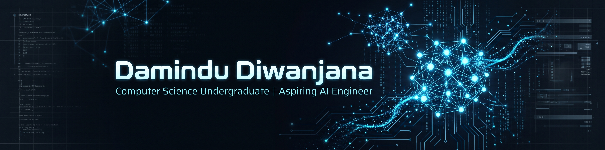

### Hi there 👋, Welcome!

  

Hello! 👋 My name is **Damindu Diwanjana**. I am a Computer Science Undergraduate from Sri Lanka with a strong passion for **Artificial Intelligence, Machine Learning, and Software Development** 🚀.

I enjoy building data-driven applications, training ML models, and exploring Deep Learning, Computer Vision, and Generative AI 🤖. Alongside my studies, I actively take part in student community initiatives and tech projects 💡.

#### **Skills:**
AI & Machine Learning | Deep Learning | Data Science | Python & SQL Development | Software Engineering

#### **Tools & Technologies:**

  

- 🔭 I’m currently working on **AI/ML projects and end-to-end intelligent applications**
- 🌱 I’m currently learning **Deep Learning, LLMs, and AI Engineering workflows**
- 📫 How to reach me: **rkaddiwanjana04@gmail.com** | **LinkedIn (in/damindu-diwanjana)**
- 😄 Pronouns: **He/Him**
- ⚡ Goal: **Building impactful AI solutions that solve real-world problems**

#### **Let's Connect:**

  
  &nbsp;
  
  &nbsp;
  

